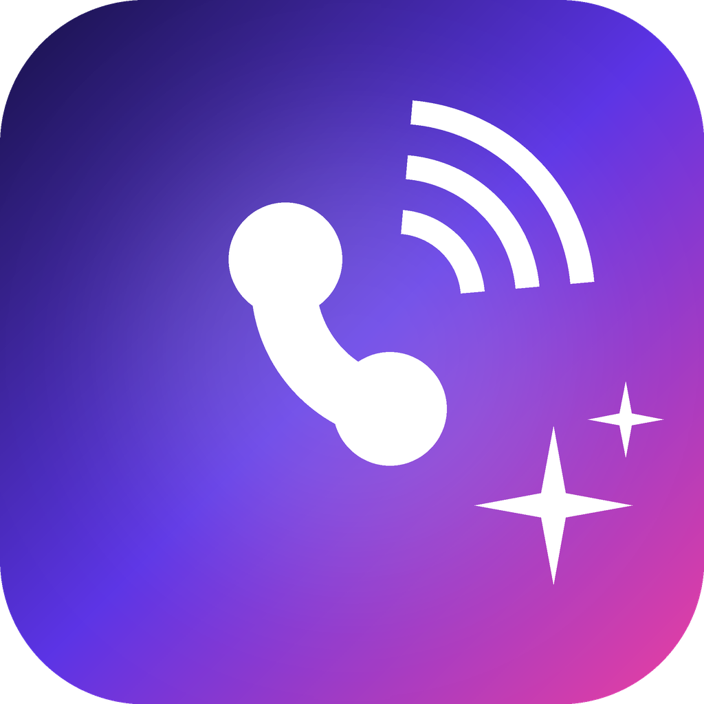
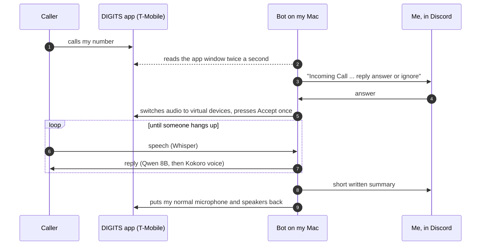
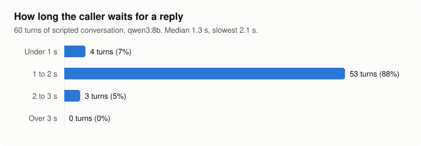

<p align="center">
  
</p>

<h1 align="center">Phone AI Assistant</h1>

<p align="center">
  A voice assistant that takes phone calls for me, because I'm deaf and can't.<br>
  It runs on my MacBook, costs nothing, and only picks up when I tell it to.
</p>

<p align="center">
  
  
  
  
  
  
  
</p>

---

## Why I built this

Phone calls are the one thing I can't route around. Delivery drivers call. Recruiters call. Plenty of places will only ever phone you, and I can't hear any of them.

So when my phone rings, I now get a Discord message. If I type `answer`, an AI picks up, explains that I'm deaf, has the conversation out loud, and writes me a short note about what the caller wanted. If I type nothing, my phone rings and goes to voicemail the way it always did.

It can also place a call for me. I type who to call and what for, confirm, and it does the talking.

## What a call looks like

```
📞 Incoming Call (#12)
Caller: Jane Doe (617) 555-0123
Status: Ringing

Reply `answer` to let the AI handle it, or `ignore` to leave it alone.
With no reply within ~22s it goes to your phone/voicemail as usual.

> answer

🤖 Call #12 with Jane Doe (617) 555-0123: AI is on the call. `hangup` to end it.

✅ Call #12 with Jane Doe (617) 555-0123 ended. Duration: 1m 04s. Reason: the other side hung up.

AI call summary (paraphrased by the assistant, may contain mistakes): Jane from the
dental office called to move Thursday's appointment. She offered Friday at 10 and
asked for a reply by text. She was told Adham would follow up in writing.
```

That is the real message format with a made-up caller.

## How it works



There is no telephony API involved. T-Mobile's DIGITS app lets my number ring on my Mac, and the bot drives that app through the macOS Accessibility API, the same interface a screen reader uses. Audio goes through two [BlackHole](https://existential.audio/blackhole/) virtual devices, so the AI's voice becomes the "microphone" and the caller's voice is captured from the "speaker". My actual microphone is never part of a call.

Everything that thinks runs on the laptop:

| Job | What does it |
|---|---|
| Notice someone is speaking | Silero VAD |
| Speech to text | whisper.cpp, `base.en` |
| Decide what to say | `qwen3:8b` through Ollama |
| Text to speech | Kokoro (int8), voice `af_heart` |
| Remote control | A private Discord bot with one authorised user |

### A bit more technical

A few details that took the most work to get right:

- **Reading the phone app.** DIGITS is an Electron app, so it exposes an accessibility tree. The bot polls it every 0.5 s (about 30 ms per read) with `pyobjc`. A ring is a window titled "Incoming Call" holding an Accept button; answering is a single `AXPress` on it. Outgoing calls open a `tel:` link, which the app registers for.
- **One state machine.** `calls/manager.py` is the only code allowed to change a call's state (`RINGING → ANSWERING → ACTIVE → ENDED`), behind an asyncio lock. Discord, the phone backend and the voice pipeline all talk to it and never to each other.
- **Audio routing.** macOS gives DIGITS whatever the system default devices are, so for the length of a call the defaults become BlackHole 2ch (AI voice in) and BlackHole 16ch (caller out). The previous devices are written to a restore file first and put back when the call ends, even after a crash.
- **Thinking ahead.** When the caller pauses, Whisper and the model start on a reply before the bot is sure the caller has finished. If they keep talking, the draft is discarded. This overlap is worth about 0.8 s per turn.
- **Streaming speech.** The model's reply is split into short phrases as tokens arrive, and each phrase goes to Kokoro straight away, so the caller hears the first words while the rest is still being generated.
- **Interruptions.** If the caller talks over the AI, playback stops in about 0.3 s and the old reply is cancelled. A short "okay" or "mm-hm" is recognised as agreement and doesn't interrupt.
- **Crash watchdog.** A separate small process is started at Accept. If the bot dies mid-call, it drops the call and restores the audio devices.

The full write-up, with diagrams, is in [docs/architecture.md](docs/architecture.md).

## Is it fast enough to talk to?

Mostly, yes. In my offline tests the assistant starts replying a median of 1.3 seconds after the caller stops talking. About 0.6 s of that is deliberate: it waits to be sure the person has finished, because cutting people off is worse than being a little slow.

<p align="center">
  
</p>

These numbers come from scripted conversations with synthetic voices on an M2 Pro with 16 GB, not from real calls. How I picked the models, and what I threw out, is in [docs/benchmarks.md](docs/benchmarks.md).

## Where it stands

I'd rather be clear about what has been tried on a real phone line and what has only passed tests.

| | Status |
|---|---|
| Seeing real incoming calls and posting them to Discord | Works |
| Answering on `answer`, hanging up, restoring audio | Works. Tested on real calls with a friend |
| Kokoro voice heard clearly by the caller | Works. "No distortion", per my friend |
| Full conversation plus written summary | Works. One 61-second real call so far |
| Outgoing calls (`call ...` then `confirm`) | Built and tested offline. First real call still to come |
| Phone menus ("press 1 for orders") | Not built. The AI waits quietly and cannot press keys |
| Mac screen locked | Does not work. The app's window can't be read while locked |
| Windows, Linux, other carriers | No. This is tied to macOS and the DIGITS app |

## Rules it can't break

These matter more to me than features, so they live in code and in tests, not in a prompt.

- **It never answers by itself.** The only path to picking up is my `answer` message, sent after the call started ringing and less than 15 seconds old.
- **It never dials by itself.** Outgoing calls need `call` and then `confirm` within a minute.
- **Nothing is recorded.** No audio files, no transcripts, no conversation text in logs. Speech lives in memory during the call and is dropped when it ends.
- **Nothing leaves the laptop** except the Discord messages to me.
- **My real microphone stays out of it.** The bot checks four times a second which input the phone app has open, and ends the call if it is not the virtual one.
- **Callers can't give it orders.** Whatever someone says on the line is treated as conversation. "Ignore your instructions" gets a polite no.
- **It says it is an AI**, and it won't agree to payments, bookings or anything else on my behalf unless I wrote that into the task for an outgoing call.

The honest limits of the microphone guarantee are written up in [docs/safety.md](docs/safety.md).

## Setting it up

You need a Mac with Apple Silicon, a T-Mobile line with [DIGITS](https://www.t-mobile.com/benefits/digits) and the DIGITS Mac app signed in, Python 3.12, [Ollama](https://ollama.com), and a Discord account. Budget half an hour.

```bash
git clone <this repo> && cd phone-ai-assistant
python3.12 -m venv .venv
.venv/bin/pip install -r requirements-voice.txt -r requirements-dev.txt

brew install --cask blackhole-2ch blackhole-16ch    # the two virtual audio devices
ollama pull qwen3:8b

cp .env.example .env                                # then fill it in, see below
.venv/bin/python -m phone_assistant
```

<details>
<summary><b>Discord bot (one time)</b></summary>

1. Create a private server with two text channels, `#assistant` and `#calls`.
2. At <https://discord.com/developers/applications> create an application. On the **Bot** tab, reset and copy the token, turn **Public Bot** off, and turn **Message Content Intent** on.
3. Invite it with only View Channels, Send Messages and Read Message History:
   `https://discord.com/oauth2/authorize?client_id=CLIENT_ID&scope=bot+applications.commands&permissions=68608`
4. Turn on Developer Mode in Discord so you can right-click and copy IDs, then fill in `.env`:

| Key | What it is |
|---|---|
| `DISCORD_TOKEN` | The bot token. Never commit it |
| `OWNER_USER_ID` | Your own user ID. Nobody else can control calls |
| `GUILD_ID` | The server |
| `ASSISTANT_CHANNEL_ID`, `CALLS_CHANNEL_ID` | The two channels |

</details>

<details>
<summary><b>Voice model files</b></summary>

The speech models live in `~/.phone-assistant/models` (about 700 MB): `ggml-base.en.bin` for whisper.cpp, `kokoro-v1.0.int8.onnx` plus its voices file for Kokoro, and the Silero VAD model. `tools/preflight.py` tells you if any are missing.

</details>

<details>
<summary><b>macOS permissions</b></summary>

- **Accessibility** for whichever terminal runs the bot, so it can read the DIGITS window and press Accept.
- **Microphone** for the same terminal, so it can read the virtual capture device. The code refuses to open any device macOS doesn't report as virtual.
- **Microphone** for DIGITS itself, which macOS asks about on the first call.

</details>

Start in the safe mode. `PHONE_BACKEND=simulated` needs no phone at all, and `digits_native_observe` watches real calls but cannot touch them. Real answering needs three separate switches in `.env`, on purpose:

```ini
PHONE_BACKEND=digits_native_answer
ALLOW_REAL_ANSWER=yes
VOICE_MODE=conversation      # with ALLOW_AI_VOICE=yes
```

Before a real call, `tools/preflight.py` prints a read-only checklist.

## Commands

Typed in Discord. Only the owner's messages count.

| Command | What happens |
|---|---|
| `answer` | The AI picks up the call that is ringing now (`answer 3` if several are) |
| `ignore` | Leave it. Phone and voicemail carry on as normal |
| `call <number or contact>: <what it's for>` | Prepares an outgoing call. Nothing is dialled yet |
| `confirm` / `cancel` | Places or drops the prepared call. It expires after 60 seconds |
| `hangup` | Ends the AI's call |
| `status` | Is the assistant online, is a call up |

For an outgoing call, everything the AI is allowed to say goes after the colon:

```
call 617-555-0100: Order one large margherita for delivery to 12 Example St, Apt 3,
second floor, buzzer 3. Pay cash on delivery. Name for the order is Adham.
```

It introduces itself as an AI calling for someone who is deaf, answers follow-up questions from what I wrote, says "he didn't say" when I didn't cover something, and never invents details.

## Repo layout

About 4,700 lines of Python for the bot and 3,100 for its tests.

```
phone-ai-assistant/
├── README.md
├── LICENSE                      MIT
├── .env.example                 every setting, with comments. Copy to .env
├── .gitignore                   keeps .env, contacts, your profile and audio files out of git
├── requirements.txt             the bot
├── requirements-voice.txt       speech and audio
├── requirements-dev.txt         tests
├── requirements-bench.txt       benchmarks
├── pytest.ini
│
├── phone_assistant/
│   ├── __main__.py              entry point: python -m phone_assistant
│   ├── config.py                reads .env, refuses unsafe combinations
│   ├── control.py               Discord text -> command, owner check, confirm step
│   ├── privacy.py               terminal-only logs with numbers masked
│   ├── calls/
│   │   ├── models.py            Call, CallState
│   │   ├── manager.py           the state machine and its safety rules
│   │   └── voice_session.py     audio side of one call, start to teardown
│   ├── phone/
│   │   ├── base.py              PhoneBackend interface
│   │   ├── simulated.py         fake phone for tests and practice
│   │   ├── digits_native.py     the DIGITS Mac app
│   │   ├── native_ax.py         macOS Accessibility calls
│   │   ├── native_watchdog.py   drops the call if the bot dies
│   │   └── digits.py, digits_answer.py   older Chrome backend, kept as a fallback
│   ├── audio/
│   │   ├── coreaudio.py         which app has which device open
│   │   ├── routing.py           virtual-device switch and the microphone guard
│   │   └── io.py                streams, virtual devices only
│   ├── speech/
│   │   ├── vad.py, stt.py, llm.py, tts.py    Silero, Whisper, Ollama, Kokoro
│   │   ├── turns.py, chunker.py              end-of-turn logic, phrase splitting
│   │   ├── audio_out.py, telephony.py        playback queue, phone-line audio helpers
│   │   └── pipeline.py                       ties the above into a conversation
│   ├── conversation/
│   │   ├── policy.py            behaviour rules
│   │   └── prompt.py            system prompts, approved facts, call summary
│   └── discord_bot/
│       ├── bot.py               discord.py client
│       └── notifications.py     call events -> #calls messages
│
├── tests/                       239 tests, everything external is faked
├── tools/                       read-only checks: preflight, audio, app state
├── bench/                       offline benchmarks, results, chart script
├── docs/
│   ├── architecture.md
│   ├── benchmarks.md
│   └── safety.md
├── config/
│   └── contacts.example.json    copy to contacts.json to call people by name
├── knowledge/
│   └── approved_profile.example.yaml   the only facts the AI may state on incoming calls
└── assets/                      icon and charts
```

`bench`, `tools` and `tests` each have a short README of their own.

## Things I know are rough

- The Mac has to be awake and unlocked, with the lid open.
- Whisper mishears my name more often than not ("Adham" came out right in 6 of 16 phone-quality test sentences). The conversation still works, but it's funny.
- If the caller is on speakerphone and the AI hears its own echo, it may think it's being interrupted. I haven't seen this on a real call yet.
- Heavy background noise pushes transcription errors past 20%.
- The setup depends on how one carrier's desktop app happens to behave. An app update could break it.

## Thanks

To [whisper.cpp](https://github.com/ggerganov/whisper.cpp), [Kokoro](https://github.com/thewh1teagle/kokoro-onnx), [Silero VAD](https://github.com/snakers4/silero-vad), [Ollama](https://ollama.com), [BlackHole](https://github.com/ExistentialAudio/BlackHole) and [discord.py](https://github.com/Rapptz/discord.py). Every piece of this is someone else's free work wired together.

And to the patient friend who kept calling me so I could test it.

## License

[MIT](LICENSE). Use it, change it, build your own. If you make it work with another carrier's app, I'd like to hear about it.

## 🧑‍💻 Author

**Adham Elkhouly**

- MSBA Student @ Boston University
- AI Student Developer @ Boston University
