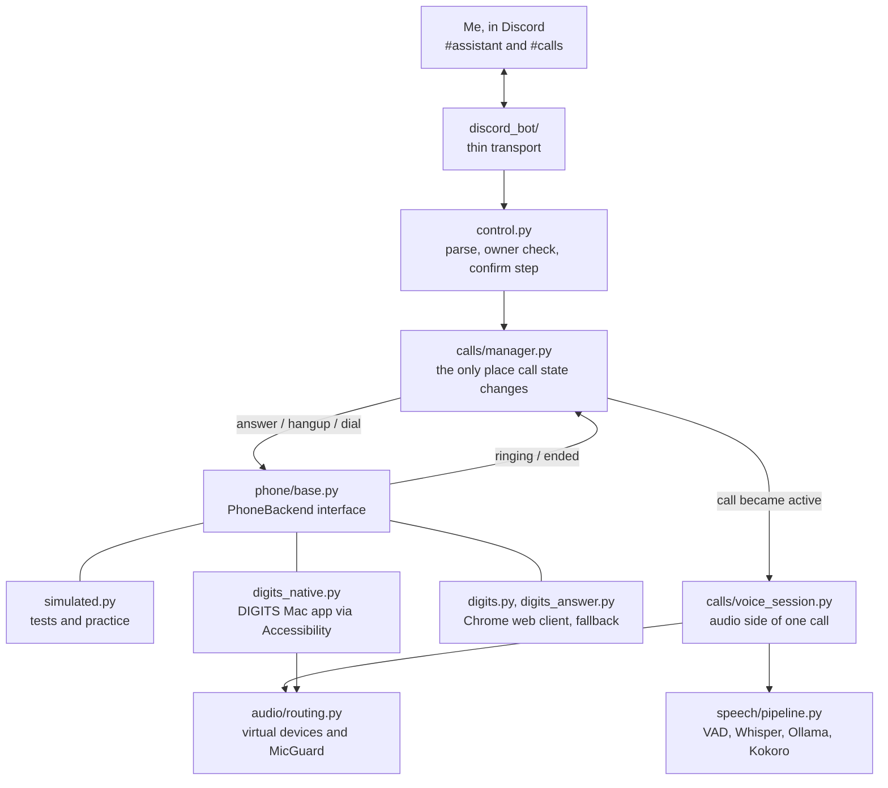
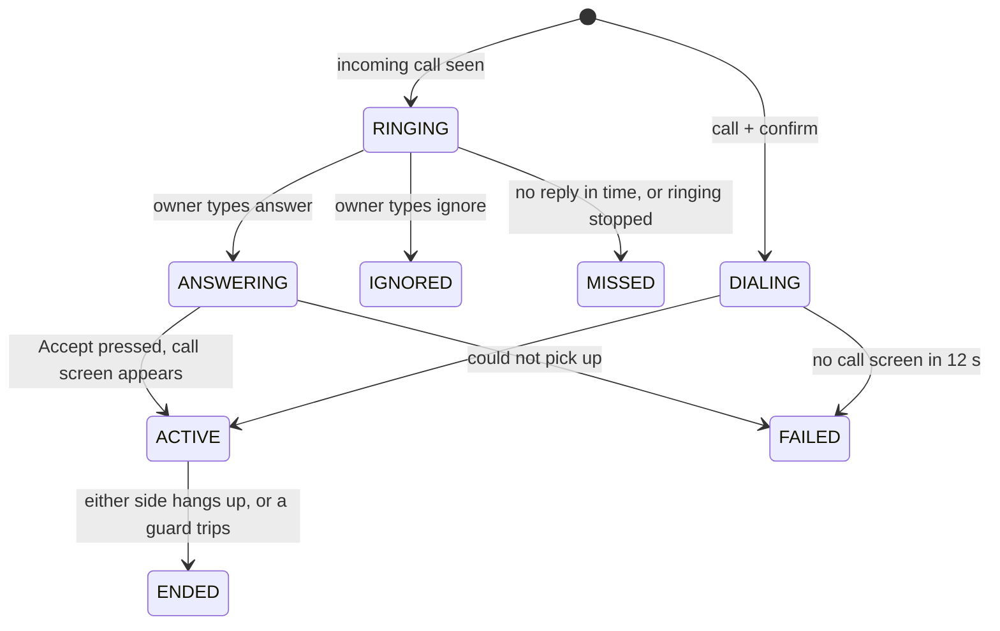
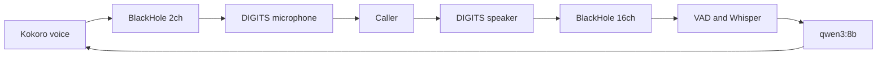

# Architecture

The short version: Discord is the remote control, the DIGITS app is the phone, and a small state machine in the middle decides whether anything is allowed to happen.

## The pieces

| Path | What it does |
|---|---|
| `calls/models.py` | `Call` and `CallState`. Metadata only: who, when, how it ended |
| `calls/manager.py` | The state machine and every safety rule. Emits events that Discord and the voice session listen to |
| `control.py` | Turns a Discord message into a command. Checks the author and the channel, resolves contacts, holds a prepared outgoing call until `confirm` |
| `discord_bot/` | discord.py client. Text and slash commands in, `#calls` posts out |
| `phone/digits_native.py` | Watches and drives the native DIGITS app |
| `phone/native_ax.py` | The macOS Accessibility calls: read a window tree, press one element, open a `tel:` link |
| `phone/native_watchdog.py` | A separate process that quits DIGITS and restores audio if the bot dies mid-call |
| `audio/coreaudio.py` | Reads which app has which audio device open |
| `audio/routing.py` | Points the Mac's default input and output at the virtual devices for one call, and puts them back. Also the microphone guard |
| `audio/io.py` | Audio streams. Refuses any device that isn't virtual |
| `speech/` | The real-time pipeline: `vad`, `stt`, `llm`, `tts`, `chunker`, `turns`, `audio_out`, `pipeline` |
| `conversation/` | The system prompts, behaviour rules, approved facts, and the end-of-call summary |
| `privacy.py` | Terminal-only logging with phone numbers masked |
| `config.py` | Reads `.env` and refuses unsafe combinations |

## Call states

`IGNORED`, `MISSED` and `FAILED` all mean the same thing for the phone: the assistant did nothing to the call, so it rings out and goes to voicemail as usual.

## How the bot reads a phone app

DIGITS is an Electron app, and Electron apps expose an accessibility tree. Twice a second the bot reads that tree, which takes about 30 ms.

- **Ringing** is a window titled "Incoming Call" with an Accept button and a Reject button. The caller's name and number are two text elements in that window.
- **Signed in** is a main window with the Settings menu and the Messages and Calls tabs.
- **Answering** is one `AXPress` on that Accept button. The code presses it once and never retries.
- **Hanging up** is the End button on the call screen. If that button can't be found, the bot quits the app, which also drops the call.
- **Dialling** opens a `tel:` link with DIGITS, which the app registers for.

There are exactly two places in the backend that press anything, Accept and End, and a test fails if a third appears. The Reject button is never referenced.

The awkward part is that this only works while the screen is unlocked. A locked Mac reports the window as empty.

## Audio

DIGITS has no device picker that I could find, so it follows the Mac's default input and output. Just before pressing Accept, the bot saves the current defaults to a small restore file, switches both to the virtual devices, and checks the switch took. If either device is missing or the switch fails, it does not answer.

When the call ends, by any route, the defaults go back. If the bot crashes, the watchdog does it. If the watchdog also dies, the bot does it at the next start.

The voice session waits until macOS reports that DIGITS has actually opened the virtual microphone before saying anything. On the first real call that took about 8 seconds after Accept, so a greeting spoken immediately would have gone nowhere.

## One turn of conversation

1. Silero VAD notices speech on the capture device.
2. When the caller pauses, the audio so far goes to Whisper, and the transcript goes to the model. This happens while the bot is still waiting to see whether the caller has finished.
3. If the caller carries on, that draft is thrown away. If they stay quiet for 0.6 s (1.4 s when the sentence trails off), the reply is already under way.
4. The model's reply is cut into short phrases as it streams, and each phrase goes to Kokoro as soon as it's complete.
5. If the caller starts talking over the AI, playback stops within about 0.3 s and the old reply is cancelled. A short "okay" or "mm-hm" doesn't count as an interruption.

Step 2 is why the median delay is 1.3 s and not 2.1 s. The benchmarks show the difference.

## Incoming versus outgoing

| | Incoming | Outgoing |
|---|---|---|
| Starts with | My `answer` | My `call ...`, then `confirm` |
| Who speaks first | The AI, with a fixed greeting | The other person. The AI stays quiet until someone says hello |
| What the AI may say | Approved facts from `knowledge/approved_profile.yaml` | Only what I wrote in the task for that one call |
| Commitments | None, ever | Only the order or booking the task describes. Never card numbers or codes |
| Ends when | Someone hangs up, or 30 s of silence | The other side hangs up. No answer after 60 s also ends it |

## Settings that gate real actions

All in `.env`, all off by default.

| Setting | Effect |
|---|---|
| `PHONE_BACKEND` | `simulated`, `digits_native_observe`, or `digits_native_answer` |
| `ALLOW_REAL_ANSWER=yes` | Required as well as the answering backend |
| `VOICE_MODE` | `off` (silence), `greeting` (one sentence), `conversation` |
| `ALLOW_AI_VOICE=yes` | Required for any voice mode other than `off` |
| `ALLOW_OUTGOING=yes` | Required for `call`. Also needs conversation mode |
| `CALL_SUMMARY` | `categories` (fixed phrases only) or `detailed` (a paraphrased note) |
| `MAX_CALL_SECONDS` | Hard time limit. `0` means no limit |

The bot refuses to start if these contradict each other, for example a voice mode without the answering backend.
